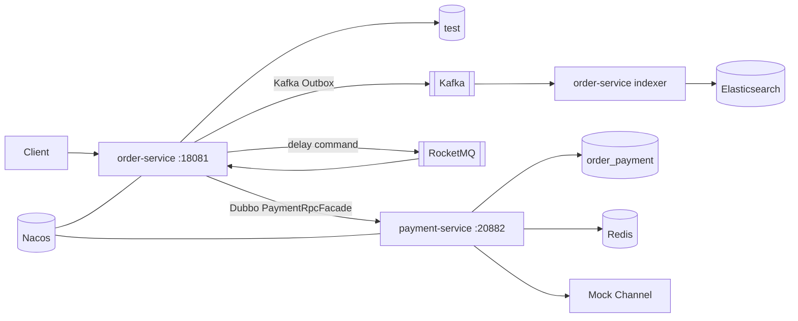
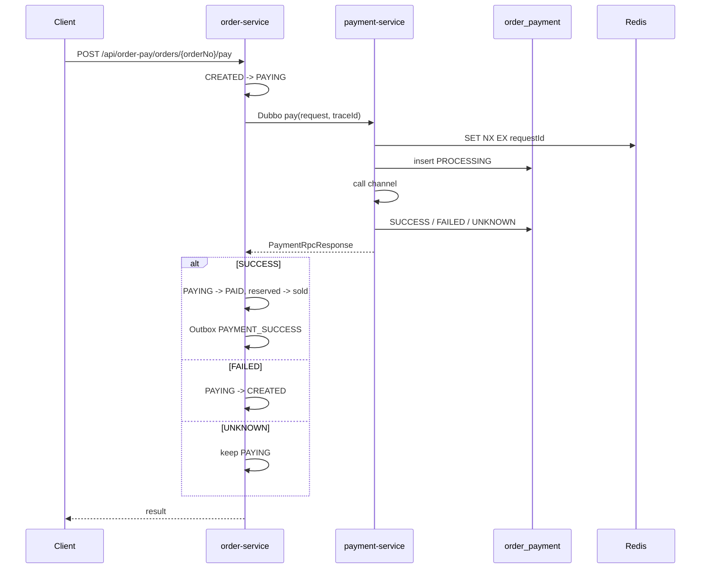

# 订单支付微服务架构

## 1. 服务边界



`order-service` 保存订单、库存和订单 Outbox。`payment-service` 保存支付流水，
通过 Redis 控制同一 `requestId` 的并发。两个服务使用独立数据库，不跨库写表。

## 2. 支付状态流



支付成功和订单状态回写不能放在同一个数据库事务中。当前实现采用同步 RPC 返回结果
推进订单状态，并以支付表唯一键、订单乐观锁和 Outbox 保证可重试与可追踪。生产环境
还应增加支付结果查询补偿任务，处理 RPC 响应丢失后的最终一致。

## 3. 数据隔离

| 服务 | 数据库 | 表 |
| --- | --- | --- |
| `order-service` | `test` | `op_order`、`op_inventory`、`op_outbox_event` |
| `payment-service` | `order_payment` | `op_payment` |
| 历史兼容表 | `test` | `op_payment`（保留旧数据，不参与新支付流程） |

初始化脚本：

- `order-service/src/main/resources/db/order-pay-schema.sql`
- `order-service/src/main/resources/db/order-pay-data.sql`
- `payment-service/src/main/resources/db/payment-schema.sql`
- `user-service/src/main/resources/script/create_user_data.sql`
- `user-service/src/main/resources/script/create_student_data.sql`
- `scripts/apply-table-column-comments.sql`（为已有 MySQL 表补列注释）

### 3.1 订单服务表字段

`op_order`：

| 字段 | 含义 |
| --- | --- |
| `order_no` | 订单业务主键。 |
| `request_id` | 创建订单幂等键，避免重复下单。 |
| `user_id` | 下单用户标识。 |
| `sku_id` | 商品 SKU 标识。 |
| `sku_name` | 下单时保存的商品名称快照。 |
| `unit_price` | 下单时保存的商品单价快照。 |
| `quantity` | 购买数量。 |
| `total_amount` | 订单总金额，等于单价乘数量。 |
| `status` | 订单状态：`CREATED`、`PAYING`、`PAID`、`CANCELLED` 或 `CLOSED`。 |
| `payment_no` | 当前支付尝试的支付单号，未支付时为空。 |
| `version` | 乐观锁版本号，订单状态每次变更时递增。 |
| `created_at` | 订单创建时间。 |
| `updated_at` | 订单最后更新时间。 |
| `paid_at` | 支付成功时间，未支付时为空。 |

`op_inventory`：

| 字段 | 含义 |
| --- | --- |
| `sku_id` | 商品 SKU 标识，同时是主键。 |
| `sku_name` | 商品名称。 |
| `price` | 当前销售单价。 |
| `total_stock` | 总库存，必须不小于预占库存与已售库存之和。 |
| `reserved_stock` | 已创建订单但尚未支付成功的预占库存。 |
| `sold_stock` | 支付成功后已确认售出的库存。 |
| `updated_at` | 库存记录最后更新时间。 |

当前可售库存按 `total_stock - reserved_stock - sold_stock` 计算。

`op_outbox_event`：

| 字段 | 含义 |
| --- | --- |
| `id` | 数据库自增主键，用于投递排序和定位记录。 |
| `event_id` | 事件业务唯一标识，用于消费端幂等。 |
| `aggregate_id` | 关联聚合标识，订单事件通常保存订单号。 |
| `event_type` | 事件类型，如 `ORDER_CREATED`、`PAYMENT_SUCCESS`、`ORDER_TIMEOUT_CHECK`。 |
| `destination` | 投递目标，当前为 `KAFKA` 或 `ROCKETMQ`。 |
| `payload` | 事件 JSON 内容，同时携带关联 TraceId。 |
| `available_at` | Outbox 最早可再次投递时间，失败重试时向后顺延。 |
| `deliver_at` | 消息业务期望投递时间，RocketMQ 延迟关单使用该字段。 |
| `status` | 投递状态，`PENDING` 待投递，`SENT` 已成功投递。 |
| `retry_count` | 投递失败后的重试次数。 |
| `last_error` | 最近一次失败原因，投递成功后清空。 |
| `created_at` | Outbox 事件创建时间。 |
| `sent_at` | 成功投递时间，尚未投递时为空。 |

## 4. Dubbo 契约

`payment-api` 是唯一契约模块：

- `PaymentRpcFacade`
- `PaymentRpcRequest`
- `PaymentRpcResponse`

两个服务通过同一 jar 加载同一份 DTO 字节码，避免同名类各自编译导致序列化不一致。
协议使用 Dubbo + `fastjson2`，注册中心为 Nacos。

macOS 上若存在 VPN，Dubbo 可能误选 `utun` 的 fake-ip 或走系统代理。
`platform-common` 会清除 JVM 系统代理并选择真实局域网 IPv4。Docker 中可自动选择
`eth0` 地址，生产部署可通过 `DUBBO_IP_TO_REGISTRY` 指定。

## 5. TraceId 与日志

- `RequestTraceIdFilter` 只处理业务 Controller 请求，跳过 Actuator、Swagger 和静态资源。
- `TraceIdDubboFilter` 将 MDC traceId 放入 Dubbo attachment。
- 支付请求 DTO 同时携带 traceId，作为跨版本兼容的备用通道。
- Outbox payload 保存 traceId，Kafka Header 和 RocketMQ Property 继续传播。
- MQ 消费者、线程池任务只调用 `openIfPresent`，不会给无关任务生成 traceId。
- `ApiErrorLoggingFilter` 对任何返回 4xx/5xx 的 API 请求兜底记录日志。
- Controller Advice 对业务、校验、Dubbo 和未知异常记录完整上下文。

验证：

```bash
curl -i -X POST \
  http://127.0.0.1:18081/api/order-pay/orders/ORD-REPLACE-ME/pay \
  -H 'Content-Type: application/json' \
  -H 'X-Trace-Id: trace-e2e-001' \
  -d '{"requestId":"PAY-REQ-001","channel":"ALIPAY"}'

rg 'trace-e2e-001' order-service/logs payment-service/logs
```

订单、支付、Outbox、Kafka、Elasticsearch 和 RocketMQ 的关联日志应使用同一个
traceId；应用启动日志应为 `traceId=-`。

## 6. 启动顺序

1. 启动 `~/docker/backend` 中已有中间件。
2. 执行 `scripts/init-order-pay-middleware.sh` 初始化 RocketMQ Topic/Group。
3. 启动 `payment-service`。
4. 启动 `order-service`。

订单服务配置了 `dubbo.consumer.check=false`，支付服务短暂不可用时仍可启动，但支付
请求会返回 503 并记录完整错误日志。
