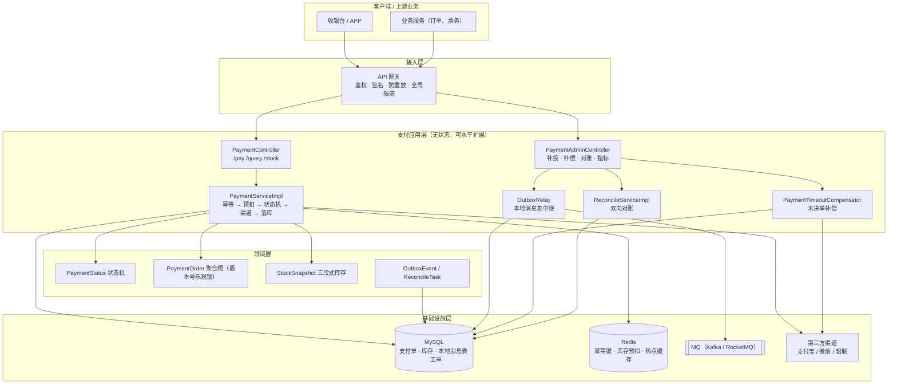
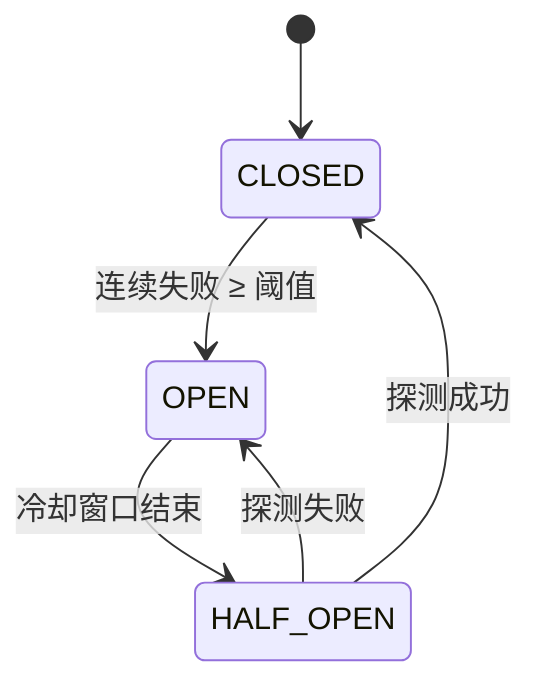
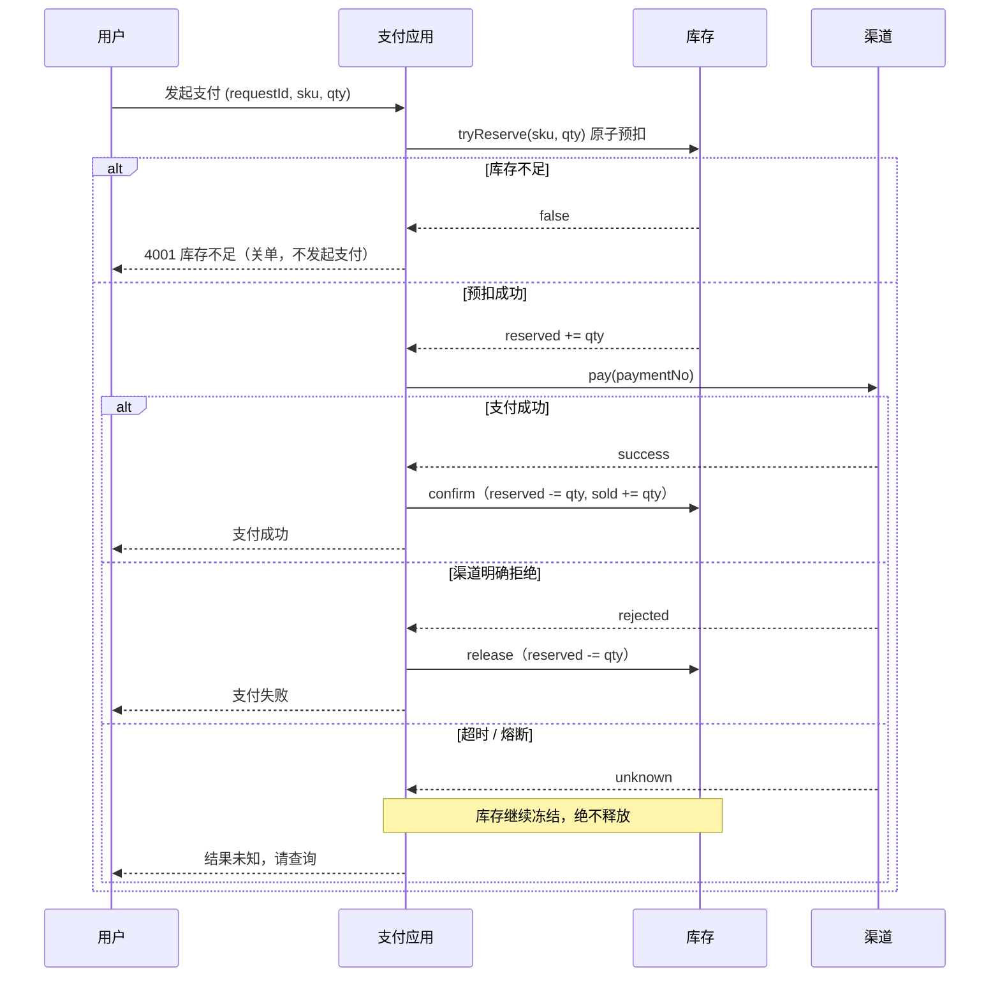
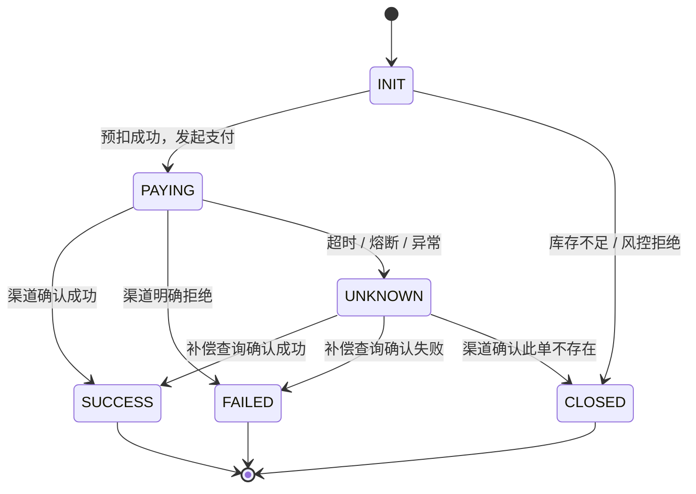
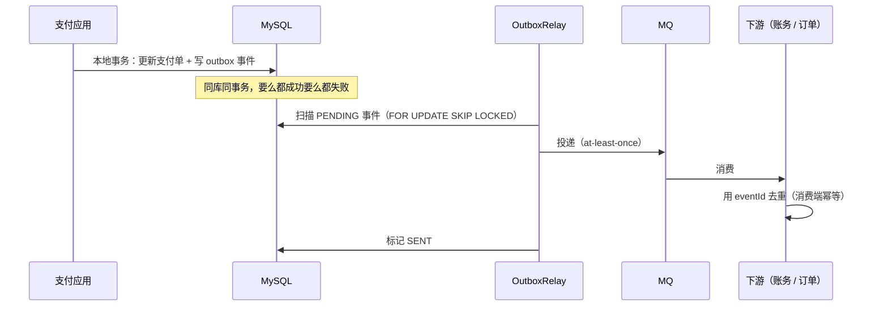
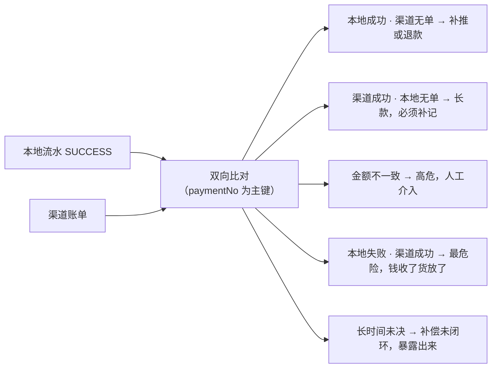
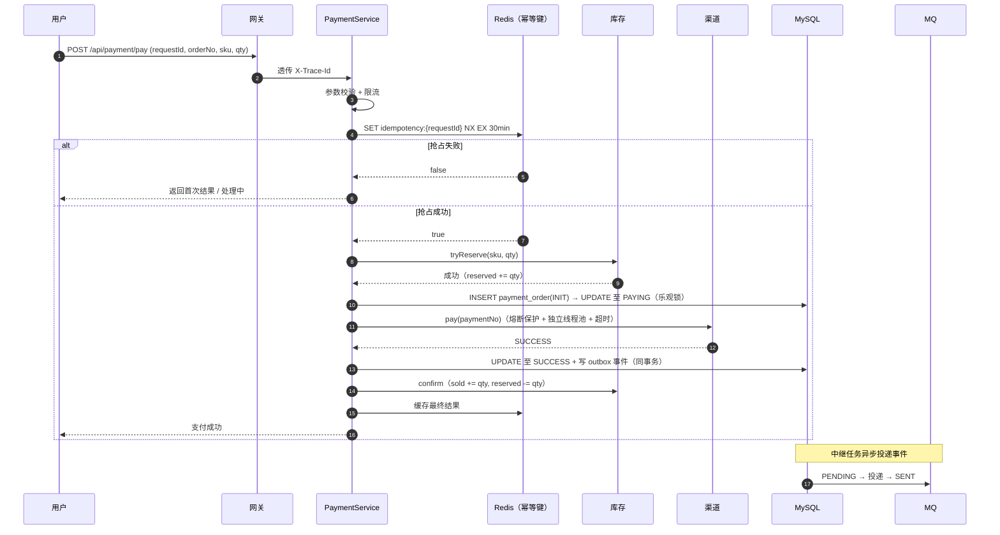

# 高并发支付接口框架设计

> 四条硬性要求：**高可用**、**不超卖**、**数据一致性**、**可复盘闭环**。
> 本文是设计说明，配套参考实现位于 `src/main/java/org/example/springboot3java21demo/payment/`，
> 并发与一致性验证位于 `src/test/java/org/example/springboot3java21demo/payment/PaymentFrameworkTest.java`。

---

## 0. 先定验收标准（SLO）

没有量化目标的架构设计都是空谈。支付链路按下表定死，后面所有设计都是为达成这些数字服务的。

| 维度 | 目标 | 保障手段 |
| --- | --- | --- |
| 可用性 | 99.99%（年不可用 ≤ 53 分钟） | 无状态多活、限流、熔断、降级、故障隔离 |
| 接口耗时 | P99 < 200ms（不含渠道），端到端 < 3s | 快速失败、缓存前置、渠道调用独立线程池 |
| 超卖 | **0 起** | 原子预扣 + 数据库约束 + 对账兜底 |
| 资金差错 | **0 笔**，任何差异都必须落工单闭环 | 状态机 + 本地消息表 + 双向对账 |
| 幂等 | 重试请求 100% 返回首次结果，绝不二次扣款 | requestId + 唯一索引 + 渠道侧幂等 |
| 可复盘 | 任意一笔支付 5 分钟内定位到全链路轨迹 | traceId 贯穿 + 事件留痕 + 工单 |

---

## 1. 整体架构



### 分层职责

| 层 | 职责 | 不该做的事 |
| --- | --- | --- |
| 接入层 | 鉴权、签名验签、防重放、全局限流、路由 | 不写业务逻辑 |
| 应用层 | 编排：幂等 → 预扣 → 状态机 → 渠道 → 落库 → 发事件 | 不直接拼 SQL、不解析渠道报文 |
| 领域层 | 状态机规则、库存不变式、金额与幂等约束 | 不依赖 Spring / HTTP / SDK |
| 基础设施层 | 持久化、缓存、消息、渠道适配 | 不含业务判断 |

应用层全程**无状态**：所有状态都在仓储里，所以扩容就是加机器，不存在会话粘性问题。

---

## 2. 高并发设计

### 2.1 分层削峰


每一层只放行下一层能承载的流量。**关键是限流必须快速失败**：支付链路上排队会把 RT 放大，
占满 Tomcat 线程池，进而把整个应用拖死 —— 这是最典型的雪崩触发路径。

参考实现：`support/SlidingWindowRateLimiter.java`（按秒分桶的滑动窗口，无锁 `LongAdder`）。
生产上换成 Sentinel / Redis + Lua 做集群流控，按下列维度限流：

| 维度 | 目的 |
| --- | --- |
| 用户 ID | 防单个用户刷接口 |
| 商户 ID | 防某个商户拖垮全站（租户隔离） |
| 接口 | `/pay` 与 `/query` 分开配额，保证查询永远有资源 |
| IP / 设备 | 防刷 |

### 2.2 线程池隔离（Bulkhead）

渠道调用必须走**独立线程池**，与 Web 线程池隔离：

```
Tomcat 线程池 (200)  ──►  渠道调用池（每渠道 32 线程，队列 64，拒绝策略 = 快速失败）
```

否则某个渠道抖动会吃光所有 Web 线程，把「查询支付结果」这个本该永远可用的接口也一起拖垮。
每个渠道独立配额，一家渠道故障不影响其他渠道。

### 2.3 异步化与结果确定

- 支付发起走同步：用户需要立刻知道结果
- 支付结果通知走**异步**：本地消息表 → MQ → 下游（账务、订单、通知）
- 渠道回调与主动查询双通道，谁先到谁闭环，靠状态机 + 乐观锁保证只生效一次

### 2.4 数据库层

| 手段 | 说明 |
| --- | --- |
| 分库分表 | 按 `payment_no` 哈希（对账友好）或按 `user_id`（用户维度查询友好） |
| 读写分离 | 支付写入主库；对账、报表、后台查询走从库 |
| 热点账户 | 同一收款账户串行化（应用内单线程队列）或拆分子账户 |
| 冷热分离 | 3 个月前流水归档到历史库，主表保持小而快 |

---

## 3. 高可用设计

### 3.1 熔断与降级：降级为「未知」，不是「失败」

这是支付系统最重要的一条原则：

> **没调到渠道 ≠ 没扣款。**

熔断器打开后，支付请求不直接判失败，而是返回 `UNKNOWN` 并落库，由补偿任务向渠道查询真实结果。
如果熔断时判失败并释放库存，就会出现「用户钱被扣了、货却被放回去卖给别人」的钱货两失。



一个容易写错的细节：**渠道明确拒绝不算渠道故障**，不计入熔断（余额不足是正常业务结果，
把它算进熔断会让熔断器误开）。参考实现见 `PaymentServiceImpl#callChannel`。

### 3.2 超时预算

```
用户端超时 10s  >  网关超时 5s  >  应用内部超时 3s  >  渠道 SDK 超时 2s
```

必须严格递减。反过来会出现「上游已超时重试、渠道仍在处理原请求」的重复扣款窗口。

### 3.3 重试原则

| 操作 | 能否重试 | 依赖 |
| --- | --- | --- |
| 查询支付结果 | 可以，无副作用 | — |
| 发起支付 | 只有在**同一个 requestId** 下才可重试 | 幂等键 + 渠道侧订单号幂等 |
| 写本地消息表 | 可以 | 事件 ID 去重 |
| 释放 / 确认库存 | 可以 | 条件更新自带数量校验，天然幂等 |

### 3.4 多活与容量

- 应用无状态，同城双活 + 异地冷备；Redis / MySQL 主从 + 集群
- 幂等键落在 Redis 集群，同一 requestId 必须路由到同一分片（用 hash tag 绑定）
- 容量按峰值 3 倍预留，大促前做全链路压测（见第 11 节）

---

## 4. 不超卖设计

### 4.1 三段式库存模型

不要用单个 `stock` 字段。用 `total / reserved / sold` 三段式，才能表达「支付中」这个状态：

| 字段 | 含义 |
| --- | --- |
| `total` | 总库存 |
| `reserved` | 已预扣、等待支付结果（既不能卖给别人，也还没算卖出） |
| `sold` | 已支付成功，真正卖出 |

不变式：`available = total - reserved - sold ≥ 0`，且 `reserved ≥ 0`，`sold ≤ total`。



### 4.2 三道防线

| 防线 | 位置 | 作用 | 实现 |
| --- | --- | --- | --- |
| 1 | 应用层 | 原子「判断 + 扣减」，单条语句完成 | `UPDATE inventory SET reserved = reserved + ? WHERE sku_id = ? AND total - reserved - sold >= ?`，affected rows = 1 才成功 |
| 2 | 数据库约束 | 兜住任何绕过应用的写入与程序 bug | `CHECK (reserved >= 0 AND sold >= 0 AND total - reserved - sold >= 0)` |
| 3 | 对账 | 兜住跨系统不一致 | T+1 双向比对，差异落工单 |

**为什么不用悲观锁（`SELECT ... FOR UPDATE`）？**
热点 SKU 下行锁会让所有请求串行排队，QPS 掉到几百，还容易死锁。
条件更新是乐观并发，冲突时 affected rows = 0，天然快速失败。

### 4.3 热点商品进阶（十万 QPS 级）

单行库存再快也有上限（MySQL 单行大约 1k~5k TPS）。两个手段：

1. **Redis Lua 预扣削峰**：请求先在 Redis 里原子预扣（脚本见 `PaymentConstants.STOCK_RESERVE_LUA`），
   只有拿到配额的请求才落库，DB 压力降到与库存量同阶。
2. **分段库存**：把一条库存行拆成 N 段（如 100 份），请求按 `hash(userId) % N` 打到不同段，
   把单行热点变成 N 行并发。代价是要处理「某段售罄但总量还有」：
   段内售罄后允许重新哈希到其他段，或定期做段间再平衡。

再叠加一层**本地售罄标记**（进程内 `AtomicBoolean` + 短 TTL）：售罄后直接拒绝，不打 Redis。
注意 TTL 要短，否则会误杀补货后的流量。

---

## 5. 数据一致性

### 5.1 支付单状态机



规则（实现见 `domain/PaymentStatus.java`）：

1. 状态只能按表流转，非法流转直接抛 `ORDER_STATE_ILLEGAL`，从代码层面杜绝脏数据；
2. 终态不可变，重复支付请求直接返回首次结果；
3. **`UNKNOWN` 是一等公民**，语义是「钱可能已经扣了」，绝不允许从 `UNKNOWN` 直接当未支付处理。

### 5.2 单笔一致性：乐观锁

```sql
UPDATE payment_order
   SET status = #{next}, version = version + 1, updated_at = NOW()
 WHERE payment_no = #{paymentNo} AND version = #{expectVersion};
-- affected rows = 1 才说明抢到了这次推进
```

支付主流程和补偿任务可能同时推进同一张单，乐观锁保证只有一方生效，另一方重读后重新判断。
参考实现：`support/PaymentStateMachine.java`（有界重试 + 冲突后重读，绝不基于过期状态覆盖写）。

### 5.3 幂等：三层防护

| 层 | 手段 | 覆盖场景 |
| --- | --- | --- |
| 1 | Redis `SET key NX EX` 抢占幂等键 | 高并发重复提交，只有第一个请求真正执行 |
| 2 | `UNIQUE KEY uk_request_id` | Redis 抖动 / key 过期 / 分片异常时的兜底 |
| 3 | 渠道侧 `paymentNo` 幂等 | 网络重试导致的重复下单 |

**关键决策：什么时候可以删除幂等键？**

- 可以删：订单尚未创建、任何副作用都没产生（例如参数校验失败）
- 绝不能删：已经调用了渠道（哪怕是超时）。此时删键等于允许客户端用同一个 requestId 再扣一次款

正确做法是把「未知」状态缓存下来，让客户端查询、让补偿任务闭环。

### 5.4 跨系统一致性：本地消息表（Transactional Outbox）

支付成功要通知账务、订单、营销、风控。如果直接 RPC 或发 MQ，会面临
「数据库提交了但消息没发出去」（丢消息）或「消息发了但事务回滚」（脏消息）两类问题。



**at-least-once 投递 + 消费端按 eventId 去重 = 业务上的 exactly-once 效果**，
这是业界成本最低、最可靠的最终一致方案。投递失败按指数退避重试，超过上限进入 `DEAD` 并告警，
把「静默丢消息」变成「可监控、可人工补偿」的确定性状态。

### 5.5 方案选型对比

| 方案 | 一致性 | 性能 | 复杂度 | 适用 |
| --- | --- | --- | --- | --- |
| 2PC / XA | 强一致 | 差（锁持有到全局提交） | 中 | 不建议用于支付 |
| TCC | 强一致 | 好 | 高（每个参与方要写 Try/Confirm/Cancel，还要处理空回滚与悬挂） | 资金类强一致场景 |
| Saga | 最终一致 | 好 | 中（要写补偿动作，需保证补偿幂等） | 长流程、跨多服务编排 |
| **本地消息表 + 对账** | **最终一致** | **最好** | **低** | **支付结果通知、账务记账（本框架采用）** |

选型理由：支付主链路（扣款 + 库存）在本地事务内完成，天然强一致；
跨系统部分（通知、记账）用最终一致 + 对账兜底，比 TCC 少一个数量级的复杂度，
而期末对账能 100% 发现差异 —— 资金业务里，「能发现」比「理论上不出错」更可靠。

### 5.6 对账：一致性的最终裁判

对账必须**双向**，单向只能发现一半问题：



每个差异生成一张 `ReconcileTask` 工单：有类型、有双方证据（金额 / 状态）、有处理状态。
**差异不是日志，是工单** —— 这就是「闭环」和「发现问题」的区别。

节奏：T+0 准实时（分钟级，扫未决单与金额异常）+ T+1 全量（渠道账单文件下载后全量比对）。

---

## 6. 可复盘闭环

### 6.1 traceId 全链路贯穿

```
用户报障「订单 123 付了钱没发货」
  → 前端响应头 X-Trace-Id
  → 网关日志（入参、限流、路由）
  → 应用日志（状态流转、渠道调用、耗时）
  → 消息事件（eventId、payload）
  → 下游消费日志
  → 对账工单（若有差异）
```

实现：`support/TraceIdFilter.java` 从上游头透传或新生成，写入 MDC 与响应头；
非 Web 入口（定时任务、MQ 消费）用 `TraceContext.currentOrCreate()` 兜底，
保证**任何**链路都有 traceId。接 SkyWalking / OpenTelemetry 时把 traceId 换成 traceparent 即可，业务代码不用改。

### 6.2 事件留痕：一笔支付的完整轨迹

每次状态变更都往本地消息表写事件（`PAYMENT_SUCCESS` / `PAYMENT_FAILED` /
`PAYMENT_UNKNOWN` / `STOCK_RELEASED` / `RECONCILE_DIFF`）。
复盘时按 `payment_no` 或 traceId 拉出事件列表，就能回放出：

```
t0  INIT      支付单创建
t1  PAYING    库存预扣成功，向渠道发起支付
t2  UNKNOWN   渠道超时（TIMEOUT）
t3  UNKNOWN   补偿查询：渠道仍在处理
t4  SUCCESS   补偿查询确认成功 → 库存 reserved 转 sold
t5  SUCCESS   PAYMENT_SUCCESS 事件已投递，账务已入账
```

这条轨迹不需要人回忆，直接从事件表读出来。

### 6.3 指标看板

| 指标 | 含义 | 告警建议 |
| --- | --- | --- |
| `payment_requests_total` | 请求总量 | — |
| `payment_success_rate` | 成功率 | < 95% 告警 |
| `payment_p99_latency` | P99 耗时 | > 500ms 告警 |
| `payment_unknown_total` | 结果未知笔数 | > 0 且持续 5 分钟告警 |
| `payment_rate_limited_total` | 被限流笔数 | 突增 10 倍告警 |
| `payment_circuit_rejected_total` | 熔断拒绝笔数 | > 0 立即告警 |
| `stock_rejected_total` | 库存拒绝笔数 | 用于容量与黄牛分析 |
| `outbox_pending_count` | 消息积压 | > 1000 或持续增长告警 |
| `outbox_dead_total` | 投递失败终态 | > 0 立即告警 |
| `reconcile_diff_total` | 对账差异笔数 | > 0 立即生成工单并告警 |
| `compensate_closed_total` | 补偿闭环笔数 | 突增说明渠道不稳定 |

参考实现：`support/PaymentMetrics.java`（内存版，生产换 Micrometer + Prometheus + Grafana）。

### 6.4 故障复盘模板

```
1. 现象    用户无法支付 / 部分订单状态异常
2. 时间线  t0 告警触发 → t1 定位 → t2 止损 → t3 恢复
3. 影响面  受影响订单数、金额、用户数（用 traceId / eventId 可精确统计）
4. 根因    直接原因 + 系统性原因（为什么监控没提前发现）
5. 止损    已执行的补偿动作（补投、补偿、对账、退款）
6. 改进    技术改进 + 监控补齐 + 演练补充，每条要有责任人和 deadline
7. 验证    改进上线后如何验证（压测、故障注入、对账连续 N 天零差异）
```

---

## 7. 关键时序：正常支付



---

## 8. 数据模型（MySQL DDL）

```sql
CREATE TABLE payment_order (
    id          BIGINT        NOT NULL AUTO_INCREMENT,
    payment_no  VARCHAR(64)   NOT NULL COMMENT '平台支付流水号，对账主键',
    request_id  VARCHAR(64)   NOT NULL COMMENT '客户端幂等键',
    order_no    VARCHAR(64)   NOT NULL COMMENT '业务订单号',
    user_id     VARCHAR(64)   NOT NULL,
    amount      DECIMAL(18,2) NOT NULL,
    channel     VARCHAR(32)   NOT NULL,
    sku_id      VARCHAR(64)       NULL,
    quantity    INT               NULL,
    status      VARCHAR(16)   NOT NULL COMMENT 'INIT/PAYING/SUCCESS/FAILED/UNKNOWN/CLOSED',
    version     BIGINT        NOT NULL DEFAULT 0 COMMENT '乐观锁',
    biz_date    DATE          NOT NULL,
    fail_reason VARCHAR(255)      NULL,
    trace_id    VARCHAR(64)       NULL,
    created_at  DATETIME(3)   NOT NULL,
    updated_at  DATETIME(3)   NOT NULL,
    PRIMARY KEY (id),
    UNIQUE KEY uk_request_id (request_id),
    UNIQUE KEY uk_payment_no (payment_no),
    KEY idx_status_updated (status, updated_at) COMMENT '补偿任务扫描',
    KEY idx_biz_date (biz_date)
) ENGINE=InnoDB DEFAULT CHARSET=utf8mb4;
```

```sql
CREATE TABLE inventory (
    sku_id     VARCHAR(64) NOT NULL,
    total      BIGINT      NOT NULL,
    reserved   BIGINT      NOT NULL DEFAULT 0,
    sold       BIGINT      NOT NULL DEFAULT 0,
    updated_at DATETIME(3) NOT NULL,
    PRIMARY KEY (sku_id),
    CONSTRAINT ck_stock_non_negative
        CHECK (reserved >= 0 AND sold >= 0 AND total - reserved - sold >= 0)
) ENGINE=InnoDB DEFAULT CHARSET=utf8mb4;
```

```sql
CREATE TABLE payment_outbox (
    event_id       VARCHAR(64) NOT NULL,
    aggregate_type VARCHAR(32) NOT NULL,
    aggregate_id   VARCHAR(64) NOT NULL,
    event_type     VARCHAR(64) NOT NULL,
    payload        JSON        NOT NULL,
    status         VARCHAR(16) NOT NULL COMMENT 'PENDING/SENT/DEAD',
    retry_count    INT         NOT NULL DEFAULT 0,
    next_retry_at  BIGINT      NOT NULL,
    trace_id       VARCHAR(64)     NULL,
    created_at     DATETIME(3) NOT NULL,
    updated_at     DATETIME(3) NOT NULL,
    PRIMARY KEY (event_id),
    KEY idx_status_retry (status, next_retry_at)
) ENGINE=InnoDB DEFAULT CHARSET=utf8mb4;
```

```sql
CREATE TABLE reconcile_task (
    task_id        VARCHAR(64)   NOT NULL,
    biz_date       DATE          NOT NULL,
    payment_no     VARCHAR(64)       NULL,
    order_no       VARCHAR(64)       NULL,
    diff_type      VARCHAR(48)   NOT NULL,
    local_status   VARCHAR(32)       NULL,
    channel_status VARCHAR(32)       NULL,
    local_amount   DECIMAL(18,2)     NULL,
    channel_amount DECIMAL(18,2)     NULL,
    status         VARCHAR(16)   NOT NULL COMMENT 'OPEN/CLOSED',
    detail         VARCHAR(500)      NULL,
    created_at     DATETIME(3)   NOT NULL,
    updated_at     DATETIME(3)   NOT NULL,
    PRIMARY KEY (task_id),
    KEY idx_biz_date (biz_date),
    KEY idx_status (status)
) ENGINE=InnoDB DEFAULT CHARSET=utf8mb4;

CREATE TABLE channel_trade_bill (
    id               BIGINT        NOT NULL AUTO_INCREMENT,
    payment_no       VARCHAR(64)   NOT NULL,
    channel_trade_no VARCHAR(64)       NULL,
    biz_date         DATE          NOT NULL,
    amount           DECIMAL(18,2) NOT NULL,
    success          TINYINT(1)    NOT NULL,
    channel_status   VARCHAR(32)       NULL,
    PRIMARY KEY (id),
    UNIQUE KEY uk_bill (biz_date, payment_no)
) ENGINE=InnoDB DEFAULT CHARSET=utf8mb4;
```

---

## 9. 代码地图

| 关注点 | 文件 |
| --- | --- |
| 状态机 | `payment/domain/PaymentStatus.java` |
| 聚合根 + 乐观锁 | `payment/domain/PaymentOrder.java` |
| 三段式库存 | `payment/domain/StockSnapshot.java` |
| 本地消息表事件 | `payment/domain/OutboxEvent.java` |
| 对账工单 | `payment/domain/ReconcileTask.java` |
| 核心编排 | `payment/service/impl/PaymentServiceImpl.java` |
| 消息中继 | `payment/service/OutboxRelay.java` |
| 未决单补偿 | `payment/service/PaymentTimeoutCompensator.java` |
| 双向对账 | `payment/service/impl/ReconcileServiceImpl.java` |
| 限流 | `payment/support/SlidingWindowRateLimiter.java` |
| 熔断 | `payment/support/PaymentCircuitBreaker.java` |
| 链路追踪 | `payment/support/TraceIdFilter.java`、`TraceContext.java` |
| 指标 | `payment/support/PaymentMetrics.java` |
| 端口定义（可替换实现） | `payment/repository/*.java`、`payment/infra/gateway`、`payment/infra/idempotent`、`payment/infra/outbox` |
| 内存实现（演示 / 测试） | `payment/infra/memory/*.java` |
| 装配 | `payment/config/PaymentConfig.java` |
| REST 接口 | `payment/controller/PaymentController.java`、`PaymentAdminController.java` |

### 端口 → 生产实现替换表

| 端口 | 演示实现 | 生产实现 |
| --- | --- | --- |
| `PaymentOrderRepository` | 内存 Map | MySQL，`UPDATE ... WHERE version = ?` + 唯一索引 |
| `InventoryRepository` | `AtomicReference` CAS 自旋 | MySQL 条件更新（或 Redis Lua 预扣 + DB 兜底） |
| `OutboxRepository` | 内存 Map | MySQL outbox 表，`FOR UPDATE SKIP LOCKED` 扫描 |
| `IdempotencyStore` | `ConcurrentHashMap` | Redis `SET NX EX`（已提供 `RedisIdempotencyStore`） |
| `OutboxPublisher` | 打日志 | Kafka / RocketMQ 生产者 |
| `PaymentChannelGateway` | `MockPaymentChannelGateway` | 支付宝 / 微信 / 银联 SDK（保持三态返回语义） |

因为是端口 / 适配器结构，替换基础设施**不需要改一行业务代码**。

---

## 10. 本地运行与验证

### 跑测试

```bash
mvn test -Dtest=PaymentFrameworkTest
```

11 个用例覆盖四条主线：

| 用例 | 验证点 |
| --- | --- |
| 并发抢购不超卖 | 800 线程抢 100 库存 → 恰好 100 笔成功，`available = 0`，无负数 |
| 同一 requestId 幂等 | 64 线程同 key 提交 → 只有 1 张单、渠道只调 1 次、只扣 1 次库存 |
| 终态单复用结果 | 重复提交返回首次 paymentNo |
| 渠道拒绝释放库存 | 失败后库存回到初始值，事件留痕完整 |
| 未知结果补偿闭环 | 超时 → 库存冻结 → 补偿查询确认成功 → 补记已售 |
| 本地消息表最终一致 | 投递失败自动退避重试，最终全部 SENT |
| 双向对账 | 金额不一致、本地失败渠道成功、渠道长款三类差异全部落工单 |
| 限流快速失败 | 超额请求返回 429，不产生业务副作用 |
| 限流窗口跨秒正确性 | 跨秒不会误清当前窗口计数（回归用例） |
| 熔断降级 | 熔断后一律 `UNKNOWN`，绝不判失败 |
| 状态机合法性 | 非法流转与终态改写被拒绝，version 单调递增 |

### 手工联调

```bash
# 启动应用（需要 MySQL + Redis，配置见 application.yaml）
mvn spring-boot:run

# 发起支付
curl -X POST http://localhost:8081/api/payment/pay \
  -H 'Content-Type: application/json' \
  -H 'X-Trace-Id: demo-trace-001' \
  -d '{"requestId":"REQ-1","orderNo":"ORD-1","userId":"U1","amount":2.00,
       "channel":"MOCK","skuId":"DEMO-SKU-001","quantity":1}'

# 重复提交同一个 requestId → 返回相同 paymentNo，duplicate = true
curl 'http://localhost:8081/api/payment/query?requestId=REQ-1'

# 查看库存（total / reserved / sold）
curl 'http://localhost:8081/api/payment/stock?skuId=DEMO-SKU-001'

# 运维闭环
curl -X POST 'http://localhost:8081/api/payment/admin/outbox/relay'
curl -X POST 'http://localhost:8081/api/payment/admin/compensate'
curl -X POST 'http://localhost:8081/api/payment/admin/reconcile'
curl 'http://localhost:8081/api/payment/admin/metrics'
```

`@Scheduled` 已随 `PaymentConfig` 打开：中继每 2s、补偿每 5s 自动跑一轮，
可通过 `payment.outbox.relay-interval-ms` / `payment.compensate.interval-ms` 调整。

常用可配置项：

| 配置 | 默认值 | 说明 |
| --- | --- | --- |
| `payment.idempotency.store` | 内存 | 设为 `redis` 启用 `RedisIdempotencyStore` |
| `payment.demo.sku-id` / `stock-total` | `DEMO-SKU-001` / 1000 | 演示库存 |
| `payment.demo.channel.success-rate` / `unknown-rate` | 1.0 / 0.0 | 模拟渠道行为，用于演练降级 |
| `payment.channel.circuit.failure-threshold` | 20 | 熔断阈值 |
| `payment.rate-limit.max-requests` | 5000 | 单机每秒配额 |
| `payment.compensate.unsettled-timeout-ms` | 30000 | 多久没闭环才进入补偿 |

---

## 11. 压测与上线验收 Checklist

**容量**

- [ ] 单接口压测到目标 QPS 的 3 倍，P99 达标且错误率不抬升
- [ ] 全链路压测（含渠道 mock），确认线程池、连接池、GC 无瓶颈
- [ ] 数据库条件更新在热点 SKU 下的实际 TPS 达到预期，不达标就启用分段库存
- [ ] 消息积压演练：MQ 停机 10 分钟后恢复，outbox 全部补投且无重复业务效果

**正确性**

- [ ] 超卖压测：库存 N，打 10N 请求 → `sold == N`、`reserved == 0`、无负数
- [ ] 幂等压测：同 requestId 打 1000 次 → 只产生 1 笔
- [ ] 故障注入：渠道超时率 100%、熔断打开、Redis 不可用，分别验证降级行为
- [ ] 对账演练：人工制造 4 类差异，验证全部落工单
- [ ] 补偿闭环：制造 100 笔未决单，验证全部闭环且库存与资金一致

**可观测**

- [ ] 每个请求都能通过 traceId 串到渠道调用与 MQ 事件
- [ ] 指标看板与告警规则上线，告警能真实触达值班人
- [ ] 灰度与回滚方案演练过（新版本 5% 流量 → 观察对账零差异 → 全量）

---

## 12. 演进路线

| 阶段 | 目标 | 关键动作 |
| --- | --- | --- |
| 第一阶段（当前） | 单机跑通整套机制 | 本框架 + 内存实现 + 自动化测试 |
| 第二阶段 | 接入真实存储 | MySQL 条件更新、Redis 幂等、outbox 表；引入 Micrometer / Prometheus |
| 第三阶段 | 高并发加固 | 分段库存、Redis Lua 预扣、渠道线程池隔离、Sentinel 集群限流、分库分表 |
| 第四阶段 | 多活与自动化 | 同城双活、对账全自动闭环、差异自动补单 / 退款、混沌工程常态化演练 |

每一步都保持「先能对账，再谈性能」的顺序 —— 一致性是这个系统的地基，
性能永远可以在一致性之上做优化，反过来则不成立。
